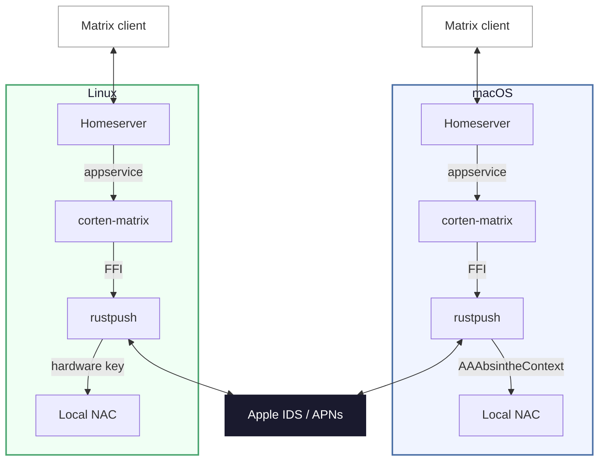

# Bridge guide

This is the user guide from the corten-matrix README in its 2026-11-01
MPL-2.0 source archive, with macoun-matrix's additions to the command table
and the Groups section. It is kept because the feature, command,
configuration and privacy sections describe this bridge too.

The sections about upstream's binary releases, installers and updater are
left out; to install macoun-matrix follow [setup.md](setup.md). Where the text
says `corten-matrix` for the command, the macoun binary is `macoun-matrix`,
and the `setup` and `update` flows it mentions are upstream's and are not
tested here.

---

## The `corten-matrix` CLI

The `corten-matrix` binary is both the bridge and its management CLI - it brings setup, service control, and updates together in one tool. Run `corten-matrix help` for the list:

| Command | What it does |
|---|---|
| `corten-matrix setup` | Configure and start the bridge against a self-hosted homeserver. Idempotent - re-run to flip feature toggles. |
| `corten-matrix setup-beeper` | Same, but configured for Beeper. |
| `corten-matrix setup 1` / `setup-beeper 1` | Add a **second** iMessage account (a different Apple ID), or reconfigure an existing one later - the same prompts as `setup`, scoped to the second bridge. |
| `corten-matrix start` / `stop` / `restart` | Control the running bridge service (launchd on macOS, systemd on Linux). One service runs both accounts. |
| `corten-matrix status` | Show the service status. |
| `corten-matrix logs 1` | Tail the live bridge log; `1` = second account. |
| `corten-matrix login` | Re-run the interactive iMessage login (Apple ID + password + 2FA, or hardware key on Linux). |
| `corten-matrix install-service` / `uninstall-service` | Install or remove the background service without re-running full setup (`corten-matrix uninstall` is an alias of `uninstall-service`). `install-service` **will not overwrite a service unit it did not create** - the installer writes a richer unit than it can reproduce, and replacing that one breaks the install. If a unit is already there it refuses and tells you to use `uninstall-service` first. `uninstall-service` removes the unit from both the user and system scopes, and reports failure rather than success if anything survives. |
| `corten-matrix reset` | Reset bridge state - prompts for confirmation (`--yes` to skip); see the warning under [Configuration](#configuration). |
| `corten-matrix update` | **Official binary releases only.** Update in place to the latest release and restart - see [Updating](setup.md#8-upgrades). |
| `corten-matrix update check` / `update force` | `check` previews the latest version + release notes without installing; `force` re-downloads and reinstalls the current release. |
| `corten-matrix bbctl <args>` | Beeper bridge-manager CLI (register / auth / stop / delete the bridge in Beeper infra). |
| `corten-matrix help` | Show the command list. |

> `update` is available on the official prebuilt binaries, which are the only supported way to run the bridge.

The same `start` / `stop` / `restart` / `status` / `logs` commands work on both platforms, so you don't have to remember whether the host uses `launchctl` or `systemctl` - the raw equivalents are in [Management](#management) if you'd rather wire your own thing.

### Dual accounts (two Apple IDs)

corten-matrix can bridge **two Apple IDs** on the same machine (max two), each as its own fully-isolated bridge - separate iMessage login/session, data dir, config, and Matrix appservice - run together under a **single** background service.

**Add or reconfigure a second account** - it's an explicit one-line command, there's no mid-setup prompt:

- **Add it any time** with `corten-matrix setup 1` (self-hosted) or `corten-matrix setup-beeper 1` (Beeper). You get the same configuration prompts and iMessage login, scoped to the second bridge.
- **Reconfigure it later** by re-running the same command - e.g. to flip a toggle like CloudKit backfill.

**How it works.** The two accounts never share login state. The first lives in `~/.local/share/corten-matrix`, the second in `~/.local/share/corten-matrix-1`. A single service runs *both* bridge processes (`bridge-all`), so `start` / `stop` / `restart` / `status` act on both at once; `corten-matrix logs` tails the first account and `corten-matrix logs 1` the second.

**macOS history-backfill caveat.** Each account backfills message history from either **CloudKit** (iCloud sync) or the local **chat.db** (the Mac's Messages database). chat.db only ever holds the messages of the *one* Apple ID signed into Messages on that Mac, so the two accounts can't both use it:

| Account 1 | Account 2 | Works? |
|---|---|---|
| CloudKit | CloudKit | ✅ |
| chat.db | CloudKit | ✅ |
| chat.db | chat.db | ❌ - only one local Messages database exists |

So **at most one** account can use chat.db backfill - the Apple ID signed into Messages on the Mac - and the other must use CloudKit. This only limits *history backfill*; real-time messaging works for both accounts regardless. (Linux has no chat.db, so both accounts always use CloudKit.)

## Login

There are two ways to log in:

- **Through the setup flow (default).** `corten-matrix setup` and `corten-matrix setup-beeper` detect a missing login and run the iMessage login inline at the end. This is the path almost everyone uses - answer the prompts in the terminal and you're done.
- **Through the bridge bot (alternative).** DM the bot in the Matrix management room and run the **"Apple ID (External Key)"** login flow. Useful if you skipped the setup login step, want to switch handles, or are re-logging without re-running setup. `corten-matrix login` re-runs the terminal flow.

Either path follows the same prompts: Apple ID → password → 2FA (if needed) → handle selection. On macOS, if the Mac is signed into iCloud with the same Apple ID, login completes without 2FA. On Linux, you additionally paste the hardware key from [Step 1](setup.md#3-extract-the-hardware-key).

If your Apple ID has multiple identities registered (e.g. a phone number and an email address), you'll be asked which one to use for outgoing messages. This is what recipients see your messages "from". To change it later, set `preferred_handle` in the config (see [Configuration](#configuration)) or log in again.

### SMS Forwarding

To bridge SMS (green bubble) messages, enable forwarding on your iPhone:

**Settings → Messages → Text Message Forwarding** → toggle on the bridge device.

### Receiving messages

Incoming iMessages automatically create Matrix rooms. History backfill uses **CloudKit** by default - that's the modern, supported path and what almost everyone should pick.

**Local chat.db** (`backfill_source: chatdb`) is a last-resort fallback for older macOS versions that can't run CloudKit backfill at all. If your Mac is in that bucket, the **preferred workaround is to run the bridge on Linux instead** (extract the hardware key once via [Quick Start (Linux)](setup.md), then let the Linux bridge do CloudKit backfill normally). Only choose `chatdb` if you actually have to run the bridge on a legacy Mac and Linux isn't an option - it's macOS-only and requires **Full Disk Access** (System Settings → Privacy & Security → Full Disk Access → add the bridge binary or Terminal) to read `~/Library/Messages/chat.db`. Without FDA the bridge can't read the file and chat.db backfill silently does nothing.

## Bridge commands

In the **management room** (the bot DM, opened automatically when you log in), type commands bare - no prefix:

```
start-chat
help
logout
```

In **portal rooms** (any bridged DM or group), prefix commands with `!im`:

```
!im help
```

To abort an interactive command (a picker waiting for your reply), type `cancel` in the management room or `!im cancel` in a portal.

### Common commands

| Command | What it does |
|---|---|
| `start-chat` | Open a new iMessage DM. With no arguments, the bot walks you through phone vs. email and explains the country-code format. With an argument (`start-chat +15551234567` or `start-chat someone@icloud.com`) it skips the picker. |
| `contacts` | Search your synced contacts by name (iCloud, external CardDAV, or local macOS Contacts depending on `backfill_source` and `carddav` settings) and reply with a number to open a chat. Different from `start-chat` - use this when you don't remember the number/email. Alias: `find`. |
| `restore-chat` | List iMessage chats in the recycle bin. Reply with a number to bring one back, including its history. |
| `new-group` | Create an iMessage group: `new-group +15551234567 someone@icloud.com name Weekend trip` (two or more people, written without spaces; the name is optional). See [Groups](#groups). |
| `group-add`, `group-remove`, `group-leave` | Run inside a group's room: add or remove a person (`group-add +15551234567`), or leave the group. Adding and removing also work with the room's own invite and remove. |
| `delete-portal` | Admin only, run inside a bridged chat: delete that room and keep it deleted across restarts. Nothing is deleted on Apple's side; a new message in the chat or `restore-chat` brings it back. |
| `logout` | Sign out of iMessage. Lists active handles, you reply with a number (or `all`). The bot then walks you through the manual step at `appleid.apple.com → Devices` to fully revoke the bridge from Apple's servers. |
| `help` | Full command list, grouped by section. |

### Phone-number format for `start-chat`

Always include the country code with a leading `+`. Spaces, dashes, and parentheses are stripped automatically; you don't need to type `tel:` / `mailto:` prefixes either.

| Country | Format |
|---|---|
| USA / Canada | `+1 555 123 4567` |
| UK | `+44 20 7946 0958` |
| France | `+33 1 23 45 67 89` |
| India | `+91 98765 43210` |

A bare US number (`5551234567`) won't work - the country code is required. Look up codes at <https://countrycode.org>.

### Logging out

`logout` does the bridge-side teardown automatically - disconnects from Apple, removes the login from the bridge, kicks you from portals, and wipes the local session backup so a re-login starts from a clean slate.

The bridge has no API to deregister your IDS identity from Apple, so the success message walks you through the final step:

1. Sign in at <https://appleid.apple.com>.
2. Go to **Devices**.
3. Find the entry for the bridge (often shown as a Mac, sometimes named "Apple Device").
4. Click **Remove from account**.

Until you do step 4, Apple still considers the bridge a registered iMessage device.

## Groups

iMessage groups can be created and managed from Matrix. Carrier (SMS/MMS/RCS)
groups cannot: their rooms refuse these changes.

- **Create.** `new-group <phone or email> <phone or email> [...] [name <group name>]`
  in the management room, or the provisioning API's create-group endpoint
  (group type `group`) for clients that have a "new group" screen. Everyone
  must be reachable over iMessage; if someone is not, nothing is created and
  the reply says who. iMessage has no "create group" step: the others see the
  group when you send the first message in the new room.
- **Rename.** Change the room name. The group is renamed for everyone. A group
  name cannot be cleared from Matrix.
- **Photo.** Change or remove the room avatar. The picture is cropped to a
  square and sent as the group photo.
- **Add and remove.** Use the room's own invite and remove on a contact's
  iMessage ghost (`@imessage_...`), or `group-add <phone or email>` and
  `group-remove <phone or email>` inside the room. A person can only be added
  if they are reachable over iMessage, and iMessage only allows removing
  someone while at least three people remain. If the change cannot be made,
  the bridge puts the room back the way the group is (withdraws the invite, or
  brings the removed ghost back) and says why.
- **Leave.** `group-leave` inside the room, under the same three-person rule.
  Leaving the room itself only reaches Apple with `bridge.bridge_matrix_leave`
  enabled.

Only iMessage contacts can be in a bridged group. In these rooms you have
power level 1, one step above the ghosts, which is what lets you invite and
remove them and nothing else. Matrix cannot limit an invite to ghosts, so if
anyone else is invited the bridge withdraws the invite at once and posts a
notice. Everywhere else (direct chats, carrier groups, and older groups whose
internal id is a list of participants) invite and remove stay locked.

If a rename or photo change is refused (for example in a carrier group), the
room keeps the new name or avatar until the next sync unless
`bridge.revert_failed_state_changes` is `true` in `config.yaml`; with it the
bridge puts the old one back at once.

Those older groups can still be renamed and given a photo.

Room members follow Apple's roster. Every live message in an iMessage group
carries the sender's list of members, and the bridge joins any listed member
who is missing from the room, so a member who never writes still shows up.
Members leave the room only when Apple reports a participant change. A
resync of a group whose roster the bridge has not learned yet leaves the
members as they are.

A group started on another network (an RCS or MMS group from Google Messages,
say) is a different conversation from the iMessage group with the same
people. An iPhone may answer in the iMessage one, so the same people can
appear in two rooms, one per network. Neither bridge can merge them.

## Effects

iMessage bubble effects (Slam, Loud, Gentle, Invisible Ink) and screen effects
(Echo, Spotlight, Balloons, Confetti, Love, Lasers, Fireworks, Celebration,
Shooting Star) are bridged both ways through one content key on the message,
`com.beeper.imessage.effect`, whose value is Apple's effect id (the key Beeper's
iMessage bridge uses). The text is unchanged; invisible ink also arrives as a
Matrix spoiler. To send one, set the key on an outgoing text message. Effects
on outgoing attachments and SMS are not sent. Ids, examples and limits:
[effects.md](effects.md).

## FaceTime

The bridge stays registered for FaceTime, so Apple keeps telling it when someone
calls you. When that happens it posts a notice in the portal:

> 📞 **Incoming FaceTime call from Alice.**

You get two of these, and only these - someone is calling, or the call went
unanswered ("Missed FaceTime call from Alice."). That is the whole feature. There are no FaceTime commands, no join links, and no
way to place or answer a call from Matrix - answer on your iPhone, iPad, or Mac
like you always have. Falling back to your Apple device is the point: it does
video and audio properly, and the bridge just makes sure you know the call is
happening if you're looking at Matrix rather than your phone.

### Turning the notice off

Set `disable_facetime: true` in `~/.local/share/corten-matrix/config.yaml`, or
answer "Post FaceTime call notices?" with `n` in `corten-matrix setup` - the
setup flow asks on first install and on every re-run, so you can flip it without
editing YAML. The bridge stays registered for FaceTime either way; only the
notice goes away.

## Focus & Do Not Disturb

When a contact toggles a Focus mode (Do Not Disturb, Sleep, Work, etc.) on iOS 18+, the bridge marks it on the **chat title** - appending a 🌙 to the contact's name (e.g. "Alice 🌙") while their Focus/DND is on, and removing it when they turn it off:

- The 🌙 rides on the DM's name (a room-state change, updated in place), not a posted message - so it never bumps or unarchives the chat, and there's no timeline spam.
- The contact's Matrix ghost also gets a presence update, so clients that render presence reflect the same state.
- DM-only: a group has a single shared title, so per-member Focus can't ride on it.
- Focus is a global on/off and not per contact.

This is the closest analog to the moon Apple shows next to a name. The bridge announces itself as "available" once after startup so peer iPhones reciprocate with the key material needed to decrypt their subsequent presence updates - leave `statuskit_share_on_startup: true` for the best chance of seeing contacts' Focus state.

If you'd rather not see the indicator (or you already track Focus on another Apple device), the setup flow asks "Enable StatusKit notifications?" on first install and on every subsequent re-run, so you can flip it at any time. (Or set `statuskit_notifications: false` in `~/.local/share/corten-matrix/config.yaml`.) Disabling suppresses the 🌙 indicator and presence updates while keeping the underlying StatusKit registration intact.

## Shared Albums

iCloud Shared Albums (Photo Streams) you subscribe to surface as dedicated rooms with the album's photos and videos backfilled. Use:

| Command | What it does |
|---------|-------------|
| `shared-albums` | Browse available Shared Albums; pick one, then pick assets to download. |
| `shared-subscribe <album-id>` | Subscribe to a Shared Album by ID so the bridge watches it for new assets. |
| `shared-subscribe-token <token>` | Subscribe via the one-time invitation token from an iCloud share URL (`icloud.com/sharedalbum/...`). |
| `shared-unsubscribe <album-id>` | Unsubscribe from an album so the bridge stops watching it. |
| `shared-state` | Dump current Shared Streams state as JSON (debugging). |

A full list lives under `!im help` in the **Shared Streams** section.

## Image and video conversion

The bridge converts a handful of formats automatically so attachments render in Matrix clients and reach iMessage in formats Apple's clients accept. Two behaviours are gated on opt-in toggles; the rest run unconditionally.

### Always on, both directions

- **TIFF ↔ JPEG.** TIFF is re-encoded to JPEG at quality 95 in either direction.
- **Opus voice notes.** iMessage uses Opus in Apple's CAF container; Matrix clients use Opus in an OGG container. The bridge remuxes between the two (no re-encoding - same codec, different wrapper) in either direction.

### Always on, outgoing only

- **Other non-JPEG images → JPEG** at quality 95. PNG and similar formats sent from Matrix are re-encoded before being handed to iMessage; the Matrix event is also edited in place so other Matrix clients see the corrected file. Incoming PNG passes through unchanged.

### Opt-in, incoming only

- **HEIC / HEIF → JPEG** - gated on `heic_conversion` (default off). Decoded with `libheif`, re-encoded at `heic_jpeg_quality` (default `95`, clamped to 1–100). EXIF, ICC color profile, and XMP are preserved; orientation is normalised because `libheif` applies the rotation during decode. Animated / multi-image HEICs collapse to the primary frame with a warning. With the toggle off, HEIC bytes pass through to Matrix - modern clients (Element, Beeper) render them, older clients may not.
- **Non-MP4 video → MP4** - gated on `video_transcoding` (default off). Applies to any `video/*` MIME that isn't already `video/mp4` (`.mov`, `.m4v`, MKV, AVI, WebM, …). The bridge tries a stream-copy remux first (`ffmpeg -c copy -movflags +faststart`) - fast and lossless. If that fails, it falls back to a full re-encode (H.264 `-preset fast -crf 23` plus AAC). Audio tracks are preserved in both modes. The Matrix event ends up as `.mp4` / `video/mp4`.

### Live Photos

iMessage Live Photos arrive as a HEIC still + MOV pair. The still goes through HEIC conversion if `heic_conversion` is on; the MOV goes through video transcoding if `video_transcoding` is on. Both pieces are delivered to Matrix as adjacent messages.

### Size limit

Attachments larger than `max_attachment_size_mb` (default `100`) are **skipped entirely** - never downloaded, transcoded, or uploaded. The default matches Beeper's upload cap: the homeserver rejects anything bigger, so bridging it would only waste a download (the bytes buffer in memory while fetching), a doomed transcode, and disk - all for a guaranteed rejection, and a multi-GB attachment can exhaust RAM on a small host. CloudKit occasionally surfaces very large attachments (multi-GB videos); skipping them up front keeps a backfill from stalling on files that could never land anyway. Self-hosters whose homeserver accepts larger uploads can raise the cap - see [`max_attachment_size_mb`](#key-options), including the note about needing the RAM for it.

### Dependencies

- **`libheif`** is a runtime dependency the bridge links against. `corten-matrix setup` installs it via Homebrew (macOS) or `apt`/`dnf`/`pacman`/`zypper`/`apk` (Linux), regardless of whether `heic_conversion` is enabled.
- **`ffmpeg`** is required at runtime only when `video_transcoding` is enabled. The setup flow installs it via the same package manager when you turn the toggle on during the interactive prompts.

## How It Works

The bridge connects directly to Apple's iMessage servers using [rustpush](https://github.com/OpenBubbles/rustpush) with **local NAC validation** - no SIP bypass, no relay server, and no background process on a Mac. When `backfill_source: chatdb` is set on macOS, it additionally reads `~/Library/Messages/chat.db` for backfill and uses the local Contacts framework for name resolution; the default CloudKit path uses iCloud for both.

NAC validation runs entirely in-process on the host running the bridge:

- **macOS**: validation data is generated natively through Apple's own `AAAbsintheContext` framework.
- **Linux**: validation data is generated locally from the hardware key extracted once from a Mac. The key carries everything needed, so no Mac is involved at runtime - Intel and Apple Silicon keys both work the same way, with no relay.



### Real-time and backfill

**Real-time messages** flow through Apple's push notification service (APNs) via rustpush and appear in Matrix immediately.

**CloudKit backfill** (optional, off by default) syncs your iMessage history from iCloud on first login. Enable it during `corten-matrix setup` or by setting `cloudkit_backfill: true` in config. When enabled, the login flow will ask for your device PIN to join the iCloud Keychain trust circle, which grants access to Messages in iCloud.

On the **first** install (before the bridge database exists), setup asks whether you want to cap messages per chat:

- Answer **no** and every available message is backfilled.
- Answer **yes** and pick a per-chat limit (minimum 100).

The cap can't be changed on later re-runs once the database is in place - edit `~/.local/share/corten-matrix/config.yaml` directly to change it.

**Deep history on a self-hosted homeserver.** Backfill has two halves. The
forward pass - the history each chat gets when its room is created - works on
any homeserver. The backward pass, which pages further back beyond that first
load, is driven by a queue that mautrix only runs when the homeserver supports
Beeper's batch-send extension. Synapse doesn't, so on a self-hosted server
history currently stops at what the forward pass delivered. Beeper users get
both halves.

## Privacy

The bridge's design goal is the same as every other bridgev2 bridge: **message content lives in Matrix, and the bridge's own database holds only the routing metadata needed to correlate messages, edits, reactions, and deletes.** The bridgev2 `message` table never had a body column to begin with - it stores IDs, timestamps, and sender references, nothing else.

The one place this bridge has to deviate is **CloudKit backfill**. To turn your iCloud message history into Matrix events, the sync pipeline stages pulled messages - with their plaintext bodies - in a local `cloud_message` cache. That cache is the only spot where message bodies touch disk, and the privacy layer exists to clean it back down to metadata after delivery. (The `chatdb` backfill source never stores bodies at all - it reads `~/Library/Messages/chat.db` live at query time. If you don't enable CloudKit backfill, none of the below applies; no bodies are ever cached.)

### How scrubbing works

A periodic scrubber (every 5 minutes) NULLs the plaintext columns - `text`, `subject`, `sender`, `tapback_emoji` - on `cloud_message` rows, gated by two conditions:

- **Already delivered to Matrix.** A row is only scrubbed once its GUID has a corresponding row in bridgev2's `message` table (i.e. the message reached Matrix), *or* it was deleted/unsent. A message that hasn't bridged yet is never scrubbed - bridging always comes first, so the scrubber can never blank a message out from under the backfill pipeline.
- **Past a 5-minute grace window.** Freshly-ingested rows get a buffer (keyed on last-ingest time) so the backfill pipeline has time to read the body before scrubbing clears it.

Scrubbing the local cache is not data loss: the canonical copy of every message stays in Messages in iCloud on Apple's servers. The `cloud_message` table is only a staging cache for backfill, never the source of truth.

On SQLite - the primary database - the bridge also sets `_secure_delete=on` for every pooled connection, so the freed pages holding the old plaintext are zeroed rather than left readable on disk. There is no equivalent on the Postgres fallback path: the columns are NULLed identically, but the scrubbed bytes sit in dead tuples until a routine `VACUUM` reclaims them (the bridge does not run `VACUUM FULL` automatically), so plaintext stays recoverable from the data files for longer.

Message **deletes and unsends** scrub the cached body right away - not waiting for the periodic tick - and are fail-closed. For inbound (Apple-side) deletes and unsends, a scrub failure makes the bridge skip emitting the Matrix removal, so the row stays scrub-eligible rather than leaking plaintext. For outbound (Matrix-initiated) redactions, the scrub failure is reported back to the framework so it won't drop its own message row before the body is cleared. The row itself is kept (soft-deleted, body NULLed) for echo detection - it isn't removed from the cache.

### Logs

In the bridge's own connector code, raw iMessage handles (phone numbers, email addresses) and full URLs are not written to logs: handles are replaced with a stable, non-reversible token (SHA-256 → UUID form) so you can still correlate one person across log lines without recording the PII, and URLs are reduced to scheme+host. This is anonymization at the log-write boundary - the values used for routing, handle matching, and StatusKit alias resolution are always the real ones, so functionality is unaffected.

**Caveat:** this covers log lines emitted by this connector (`pkg/connector`). The underlying bridgev2 framework emits its own logs and can still print raw handles/identifiers in its messages - those are outside the connector's control. So "anonymized logs" means the connector's own output, not a guarantee across every line in the file.

### What is *not* scrubbed (by design)

- **Attachment metadata** (`attachments_json`) - filenames, MIME types, sizes, and CloudKit record-names. The record-name is required to re-pull a file from Apple if a Matrix upload fails after bridging. The attachment *bytes* live in CloudKit, not the DB.
- **Chat metadata** (`cloud_chat`) - group display names and participant handles, kept so a conversation's identity (name, members) survives across re-syncs without a refetch.

### Debugging

Everything above is on by default and has no config toggle. The single escape hatch is `debug_disable_privacy` (see [Key options](#key-options)) - a development-only switch that turns off log anonymization and the scrubber and re-fills previously-scrubbed plaintext on the next sync. Leave it `false` in any real deployment.

## Management

The `corten-matrix` CLI is the easy path - `corten-matrix start | stop | restart | status | logs` work the same on both platforms. The raw equivalents (and other knobs) are below if you'd rather wire your own thing.

### macOS

```bash
# View logs - bridge.log is structured JSON; `corten-matrix logs` renders it readably
tail -f ~/.local/share/corten-matrix/logs/bridge.log            # first account (raw JSON)
tail -f ~/.local/share/corten-matrix-1/logs/bridge.log          # second account, if configured
tail -f ~/.local/share/corten-matrix/logs/bridge.stdout.log     # raw process stdout + crash output

# Restart (auto-restarts via KeepAlive)
launchctl kickstart -k gui/$(id -u)/com.lrhodin.corten-matrix

# Stop until next login
launchctl bootout gui/$(id -u)/com.lrhodin.corten-matrix

# Uninstall
corten-matrix uninstall
```

### Linux

```bash
# If using systemd (from corten-matrix setup / setup-beeper)
systemctl --user status corten-matrix
journalctl --user -u corten-matrix -f
systemctl --user restart corten-matrix

# In containers (LXC) - or anywhere `systemctl --user` can't reach a session bus -
# setup installs a SYSTEM unit (/etc/systemd/system/corten-matrix.service) instead; drop `--user`:
systemctl status corten-matrix
journalctl -u corten-matrix -f
systemctl restart corten-matrix

# File logs (per account; bridge.log is structured JSON - `corten-matrix logs` renders it readably)
tail -f ~/.local/share/corten-matrix/logs/bridge.log      # first account
tail -f ~/.local/share/corten-matrix-1/logs/bridge.log    # second account, if configured

# If running directly (debugging or non-systemd hosts)
./corten-matrix -c ~/.local/share/corten-matrix/config.yaml
```

You don't have to know which mode you're in: `corten-matrix start` / `stop` / `restart` / `status` detect it - they drive the user unit when a session bus is reachable and fall back to the system unit otherwise (using `sudo` when you're not root). The raw commands above are only for wiring your own tooling.

## Configuration

Config lives in `~/.local/share/corten-matrix/config.yaml` (generated during setup). Override the data directory by setting `XDG_DATA_HOME` before running setup if you want a different location.

### Reconfiguring without editing YAML

The setup commands (`corten-matrix setup` and `corten-matrix setup-beeper`) are idempotent - re-run them any time and they detect the existing config, then walk you through interactive prompts to flip individual settings. Nothing is wiped. You can use a re-run to change:

- **Preferred handle** - pick a different `tel:` / `mailto:` from the registered list
- **External CardDAV** - change email / server / app password
- **CloudKit backfill** - enable or disable, switch between CloudKit and `chat.db` sources
- **FaceTime call notices** - enable or disable (`disable_facetime`)
- **StatusKit notifications** - enable or disable the iOS 18 Focus / DND 🌙 chat-title indicator (`statuskit_notifications`)
- **HEIC conversion / video transcoding** - toggle on or off

```bash
corten-matrix setup              # self-hosted homeserver
corten-matrix setup-beeper       # Beeper
```

The per-chat backfill cap (`backfill.max_initial_messages`) is asked only on the **first** install, before the bridge database exists. To change it later, edit `~/.local/share/corten-matrix/config.yaml` directly.

Options with no setup prompt (e.g. `read_receipts`, `typing_notifications`, `max_attachment_size_mb`) are also changed by editing `~/.local/share/corten-matrix/config.yaml` directly, then `corten-matrix restart` - see [Key options](#key-options).

> **Warning:** the next snippet deletes your bridge state. Only run it if you mean to start over.

To start completely from scratch (new homeserver, new login, blank database), tear down the service and the on-disk state, then re-run setup. `corten-matrix reset` does this interactively (and handles Beeper deregistration); to do it by hand:

```bash
# macOS
launchctl bootout gui/$(id -u)/com.lrhodin.corten-matrix 2>/dev/null
rm -f ~/Library/LaunchAgents/com.lrhodin.corten-matrix.plist
rm -rf ~/.local/share/corten-matrix
rm -rf ~/.local/share/corten-matrix-1   # second account, if you added one

# Linux
systemctl --user stop corten-matrix 2>/dev/null
rm -rf ~/.local/share/corten-matrix
rm -rf ~/.local/share/corten-matrix-1   # second account, if you added one

corten-matrix setup
```

### Key options

Most knobs live at the top level of the network connector config. Defaults shown match `pkg/imconfig/example-config.yaml`.

| Field | Default | What it does |
|-------|---------|-------------|
| `cloudkit_backfill` | `false` | Master switch for message history backfill. Requires device PIN during login to join the iCloud Keychain. |
| `backfill_source` | `cloudkit` | `cloudkit` (default) or `chatdb` (legacy macOS fallback only - macOS-only, requires Full Disk Access). For legacy Macs prefer running the bridge on Linux with CloudKit instead. Only relevant when `cloudkit_backfill` is true. |
| `url_previews_in_backfill` | `true` | Fetch link previews (og:/twitter: tags + thumbnail) for URL-bearing messages during backfill. Each URL costs up to three HTTP round-trips inline with conversion - set `false` to skip previews during backfill only (live inbound messages and outbound edits still build them). |
| `displayname_template` | *(see [example-config.yaml](../pkg/imconfig/example-config.yaml))* | Go template controlling how iMessage contacts appear in Matrix. Falls through `FirstName → LastName → Nickname → Phone → Email → ID`. Variables: `{{.FirstName}}`, `{{.LastName}}`, `{{.Nickname}}`, `{{.Phone}}`, `{{.Email}}`, `{{.ID}}`. |
| `preferred_handle` | *(from login)* | Outgoing iMessage identity in URI form (`tel:+15551234567` or `mailto:user@example.com`). |
| `read_receipts` | `true` | Send read receipts to iMessage contacts when you read their messages in Matrix. Set `false` to stop contacts from seeing when you've read their messages. Incoming read receipts from contacts are unaffected. |
| `typing_notifications` | `true` | Send typing indicators to iMessage contacts while you compose a reply in Matrix. Set `false` to hide your typing. Incoming typing indicators are unaffected. |
| `disable_facetime` | `false` | Don't post the incoming / missed FaceTime call notices. The bridge stays registered for FaceTime either way. |
| `bridge_filtered_chats` | `false` | Bridge chats iCloud filed under "Unknown Senders" instead of skipping them. That filtering comes from your iCloud settings, not the bridge, and the bucket catches real conversation too - delivery notifications, 2FA codes, a business replying to you. |
| `statuskit_share_on_startup` | `true` | Publish "available" once after startup so peer iPhones reciprocate with the key material needed to decrypt their Focus/DND state. |
| `statuskit_notifications` | `true` | Append a 🌙 to a contact's chat title (+ ghost presence) when they toggle iOS 18 Focus / DND. The underlying StatusKit registration runs either way. |
| `video_transcoding` | `false` | Auto-remux non-MP4 videos (e.g. QuickTime `.mov`) to MP4 for broad Matrix client compatibility. Requires `ffmpeg`. |
| `heic_conversion` | `false` | Auto-convert HEIC/HEIF images to JPEG. Requires `libheif`. |
| `heic_jpeg_quality` | `95` | JPEG output quality (1–100) when HEIC conversion is enabled. |
| `max_attachment_size_mb` | `100` | Skip attachments larger than this many MB - they're never downloaded, transcoded, or uploaded. The default matches Beeper's upload limit; the homeserver rejects anything larger, so bridging it just wastes bandwidth, CPU, and memory for a guaranteed rejection (and a multi-GB attachment can exhaust RAM on a small host, since attachments buffer in memory while downloading). Raise it **only** if your homeserver accepts bigger uploads - e.g. a self-hosted Synapse with a higher `max_upload_size` - **and** the host has the RAM to spare. On Beeper, raising it has no effect: the homeserver still rejects anything over 100 MB. |
| `carddav.email` / `carddav.url` / `carddav.username` / `carddav.password_encrypted` | *(unset)* | External CardDAV server for contact name resolution (Google with app passwords, Nextcloud, Radicale, Fastmail, etc.). Set up via the setup flow's CardDAV prompt. When configured, used instead of iCloud contacts. |
| `backfill.max_initial_messages` | `2147483647` | Cap on messages per chat for the initial backfill (`2147483647` = uncapped). Setup writes this when CloudKit backfill is enabled - uncapped by default, or the per-chat limit (≥100) you pick on first install. |
| `encryption.allow` | `false` | bridgev2 framework option. Set `true` to enable end-to-bridge encryption. |
| `database.type` | `sqlite3-fk-wal` | bridgev2 framework option. Setup asks during first run and defaults to SQLite. SQLite is the primary database; `postgres` is an unsupported fallback. It is not deliberately broken and portability fixes are welcome, but it gets no testing, and problems specific to it are yours to diagnose. |
| `debug_disable_privacy` | `false` | **Development only - leave `false` in any real deployment.** Turns off log anonymization and the message-body scrubber, and re-fills previously-scrubbed plaintext on the next CloudKit sync. See [Privacy](#privacy). Does not undo deletes/unsends and does not re-deliver anything to Matrix. |

## Source layout

```
cmd/corten-matrix/                          # Bridge entrypoint + management CLI dispatch
  ├── main.go                               #   process bootstrap, config load, subcommand switch
  ├── login_cli.go                          #   interactive iMessage CLI login (stdin → bridgev2 LoginProcess)
  ├── ensure_config.go                      #   config bootstrap helper
  ├── carddav_setup.go                      #   setup helper - CardDAV URL discovery + password encryption
  ├── setup_darwin.go                       #   macOS chat.db / Full Disk Access permission dialogs
  ├── setup_other.go                        #   non-Darwin stubs (no-ops)
  ├── meminfo_*.go / memlimit.go            #   memory-limit detection per platform
  └── rlimit_*.go                           #   file-descriptor limit bump

pkg/cli/                                    # Management CLI (setup / start / stop / logs / bbctl / …)
  ├── cli.go                                #   subcommand dispatch, service install (launchd/systemd), help
  └── ui.go                                 #   terminal styling helpers

pkg/connector/                              # bridgev2 connector - the main Go bridge package
  ├── connector.go                          #   bridge lifecycle + platform detection
  ├── client.go                             #   send/receive/reactions/edits/typing
  ├── login.go                              #   Apple ID + external-key login flows
  ├── commands.go                           #   `start-chat`, `logout`, `restore-chat`, `msg-debug`, …
  ├── command_contacts.go                   #   `contacts` command - search + iMessage validation
  ├── statuskit_commands.go                 #   StatusKit (Focus / DND) commands
  ├── statuskit_cloudkit.go                 #   StatusKit CloudKit pull - fetches + injects peer presence records
  ├── statuskit_alias_resolver.go           #   StatusKit alias-cluster resolver
  ├── sharedstreams.go                      #   iCloud Shared Albums commands + sync
  ├── shared_profile.go                     #   Name & Photo Sharing fallback
  ├── external_carddav.go                   #   external CardDAV contact resolution
  ├── carddav_crypto.go                     #   app-password encryption for carddav config
  ├── cloud_contacts.go                     #   iCloud CardDAV contact sync (DSID + mmeAuthToken)
  ├── contacts_local_darwin.go / _other.go  #   macOS Contacts framework lookups + non-Darwin stub
  ├── contact_merge.go                      #   dedupes portals across multiple handles per contact
  ├── chatdb.go / chatdb_darwin.go          #   chat.db backfill + contacts (macOS)
  ├── permissions_darwin.go / _other.go     #   macOS Full Disk Access checks/prompts + stub
  ├── bridgeadapter.go                      #   adapter to the legacy `imessage.Bridge` interface
  ├── identity_store.go                     #   persists APSState / IDSUsers / IDSIdentity
  ├── group_identity.go                     #   detects group portal IDs from sender + participants
  ├── ids.go                                #   identifier ↔ portal ID conversion
  ├── idskeys.go                            #   outbound delivery-identity precheck before send
  ├── dbmeta.go                             #   portal/ghost/message/login metadata types
  ├── sync_controller.go                    #   APNs-driven real-time event dispatch
  ├── ford_cache.go                         #   Ford key cache (cross-batch MMCS dedup)
  ├── attachment_retrier.go                 #   layer-2 MMCS retry - re-downloads failed attachments
  ├── pending_attachment_store.go           #   DB-backed queue of attachments awaiting retry
  ├── cloud_backfill_store.go               #   CloudKit backfill message store + paging
  ├── recycle_bin_hints.go                  #   recoverable-message metadata for CloudKit recycle bin
  ├── macoun_recycle_bin.go                 #   local copy of the CloudKit recycle bin, read incrementally
  ├── macoun_attachment_index.go            #   encrypted index of the CloudKit attachment zone
  ├── macoun_startup_hold.go                #   which incoming messages wait for the startup pass
  ├── macoun_provider_status.go             #   Mac relay outage and recovery as bridge states
  ├── macoun_delete_portal.go               #   delete-portal that records the deletion
  ├── macoun_groups.go                      #   create, rename, photo and membership of iMessage groups from Matrix
  ├── macoun_group_commands.go              #   new-group, group-add, group-remove, group-leave
  ├── heic.go                               #   HEIC → JPEG conversion (libheif)
  ├── audioconvert.go                       #   audio remux to M4A / CAF
  ├── urlpreview.go                         #   OpenGraph / Twitter Card URL-preview extractor
  ├── diskspace_unix.go / _other.go         #   free-space checks
  ├── util.go                               #   phone normalization + group-key helpers
  ├── capabilities.go                       #   advertised feature set
  ├── config.go                             #   bridge config schema (YAML + `upgradeConfig` helper)
  └── *_test.go                             #   unit tests

pkg/imconfig/                               # config defaults + example-config.yaml template
pkg/bbctl/                                  # Beeper bridge-manager (register / auth / stop / delete),
                                            #   invoked as `corten-matrix bbctl <args>`

pkg/rustpushgo/                             # Rust FFI wrapper (uniffi → cgo)
  ├── src/lib.rs                            #   FFI surface - login / send / receive / CloudKit / Ford
  ├── src/anisette.rs                       #   Linux remote-anisette wrapper (panic/timeout guards)
  ├── src/local_config.rs                   #   macOS LocalMacOSConfig (IOKit → MacOSConfig + native NAC)
  ├── src/statuskitgo.rs                    #   StatusKit invite-to-channel wrapper
  ├── rustpushgo.go                         #   uniffi-generated Go bindings
  └── build.rs                              #   uniffi codegen + Objective-C cc shim build

nac-validation/                             # Local NAC via Apple's AppleAccount.framework (macOS-only)
  ├── src/lib.rs                            #   Rust wrapper exposing `generate_nac_data` over Obj-C
  ├── src/validation_data.{h,m}             #   AAAbsintheContext bindings
  └── Cargo.toml + build.rs                 #   crate manifest + cc shim build

imessage/                                   # chat.db reader - used by macOS backfill + contacts
  ├── interface.go                          #   Bridge / API interfaces consumed by the connector
  ├── struct.go                             #   message / chat / attachment data types
  ├── tapback.go                            #   tapback (reaction) parsing
  └── mac/                                  # macOS-only chat.db backend (queries, Contacts/NSAttributedString shims)

ipc/
  └── ipc.go                                # JSON-RPC over Unix socket - legacy bridge ↔ client transport

scripts/                                    # Setup scripts, embedded into the binary via //go:embed
  ├── embed.go                              #   embeds the install scripts for the management CLI
  ├── install.sh / install-linux.sh         #   interactive setup - self-hosted bridge (macOS / Linux)
  ├── install-beeper.sh / -linux.sh         #   interactive setup - Beeper (macOS / Linux)
  ├── bootstrap-linux.sh                    #   installs build deps
  ├── reset-bridge.sh                       #   wipes state + Beeper deregistration (with prompts)
  └── patch_bindings.py / .sh               #   patches uniffi-generated Go bindings for Go 1.24+ cgo types
```

## Troubleshooting

- **Contact Key Verification must be off.** The bridge registers as a new iMessage device on your Apple ID and won't function while CKV is enabled. Turn it off before logging in: on iPhone, **Settings → [your name] → Contact Key Verification**; on a Mac, **System Settings → [your name] → Contact Key Verification**.
- **chat.db backfill silently does nothing.** The bridge is missing Full Disk Access - grant it under **System Settings → Privacy & Security → Full Disk Access** (see [Receiving messages](#receiving-messages)).
- **The extractor app won't open on the Mac.** Gatekeeper blocks the ad-hoc-signed app on first launch - see the Gatekeeper note under [Step 1](setup.md#3-extract-the-hardware-key) for the per-macOS-version override.
- **"database is locked" in the log.** SQLite allows one writer, and the bridge writes hard during a first backfill - CloudKit sync, the backfill queue and the crypto store at once. The bridge now serializes its own SQLite pool to a single connection at startup (you'll see a `[database]` line if it had to override a higher `max_open_conns`), which removes the collisions. If you still see it, something else is writing to the same file - a second `corten-matrix` process, or a CLI subcommand run against a data dir whose service is up.
- **A conversation is stuck empty while the rest backfilled fine.** A failed batch send used to leave a portal marked complete with nothing in it, permanently. The bridge now re-arms those on startup - look for `Re-armed backfill for portals that were marked done with no bridged messages`. It repairs each affected portal once.
- **Reading logs.** `corten-matrix logs` (or `logs 1` for the second account) pretty-prints the live log. On disk, `logs/bridge.log` is structured JSON (rotated), and raw process stdout / crash output lands in `logs/bridge.stdout.log` - per account under `~/.local/share/corten-matrix/` and `~/.local/share/corten-matrix-1/`.
- **Is it running at all?** `corten-matrix status`, then `corten-matrix restart` if needed - raw `launchctl` / `systemctl` equivalents are under [Management](#management).

